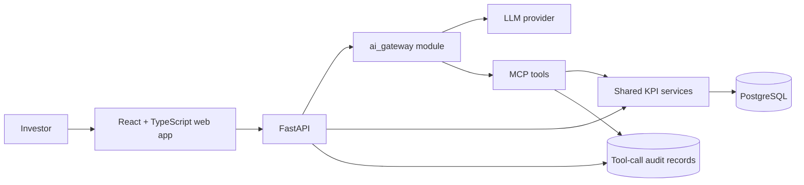

# EquityMetrics MCP — Build Instructions

## Objective

Build a small, production-minded full-stack application for public investors. It must expose curated quarterly KPI estimates through both a web chat experience and an MCP server. Optimize for fast, trustworthy answers, clear drill-down data, recoverable agent failures, and inspectable tool use.

The source dataset is `kpi_sample_2000__282_29__281_29.csv`. Treat PostgreSQL as the system of record; the LLM explains retrieved facts but must never invent a metric or value.

## Requirements to satisfy

- Search or list sectors, companies, tickers, and KPIs.
- Return a company's KPI estimates, including historical quarters and current QTD data.
- Provide 2–4 MCP tools designed for natural LLM workflows.
- Make invalid ticker/KPI requests recoverable with structured, actionable errors and suggestions.
- Persist a tool-call audit record with the tool, sanitized arguments, outcome, correlation ID, and duration.
- Provide a chat UI whose answer is produced through the MCP tools and which displays tool calls and arguments.
- Provide runnable application and MCP-client setup instructions in the final `README.md`.
- Include an architecture diagram, decision rationale, AI-use disclosure, and brief future improvements in the final `README.md`.

Do not add authentication, multi-tenancy, real-time streaming, vector search, background queues, caching, or a separate AI-gateway deployment in this build.

## Dataset contract

The supplied data has 2,000 records: 20 companies, 5 KPIs, 18 sectors, 1,600 historical observations, and 400 QTD snapshots. Its columns are:

| Column | Meaning | Rule |
| --- | --- | --- |
| `company_name`, `ticker`, `sector` | Company identity and classification | `ticker` is canonical and stored uppercase. |
| `kpi` | Human-readable metric name | Canonicalize whitespace and compare case-insensitively. |
| `period_start`, `period_end`, `period` | Fiscal interval and label | Validate `YYYYQ[1-4]`; do not infer calendar quarters. |
| `estimate_type` | `historical` or `qtd` | Reject other values. |
| `value`, `unit` | Numeric estimate and its display unit | Store exact decimal precision; never return a bare number without its unit. |
| `as_of` | QTD snapshot date | Required for QTD; optional for historical data. |

There may be multiple QTD snapshots for a `(company, KPI, fiscal period)`. “Latest QTD” means the greatest `as_of` date, not the greatest numeric value.

## Architecture and decisions



### Chosen boundaries

| Decision | Choose | Why | Do not choose yet |
| --- | --- | --- | --- |
| Application shape | Modular monolith | Keeps live-change paths short while preserving separable boundaries. | Microservices, queues, events. |
| API | FastAPI + Pydantic | Typed request/response contracts and straightforward async endpoints. | A custom HTTP layer. |
| MCP | FastMCP over shared services | Tools and web/API use identical validation and retrieval logic. | A second data-access path. |
| Persistence | PostgreSQL + SQLAlchemy + Alembic | Transactional, searchable structured facts with explicit migrations. | CSV-at-request-time, a document store. |
| Web | React + TypeScript + Vite | Small, typed UI with fast local development. | A heavy UI kit or SSR framework. |
| Styling | CSS variables and small component-local CSS | Deliberate visual hierarchy without design-system boilerplate. | A component-library dependency for a single-page task. |
| Agent integration | Internal `ai_gateway/` module | Isolates provider, credentials, tool loop, and policy while avoiding a new deployment. | A standalone gateway service. |

### AI gateway contract

`ai_gateway/` sits between FastAPI and the LLM provider. It owns provider/model configuration, API-key isolation, prompt versions, tool-loop orchestration, deterministic mock mode, request IDs, latency/token/cost metrics, retry/timeout/response-size limits, optional redaction, and a unified frontend/audit trace.

The MCP server is the authoritative data interface. The gateway may invoke tools, but may not query the database directly. Define a narrow provider-independent interface, for example `answer(question, context) -> AgentResponse`, so a future separately deployed gateway can retain the same contract. Do not create that deployment now.

### Data model and retrieval strategy

Use normalized lookup tables and one estimates table unless the implementation demonstrates a concrete reason to split history and QTD:

```text
sectors(id, name)
companies(id, sector_id, name, ticker)
kpi_definitions(id, name, display_name, unit, description)
estimates(id, company_id, kpi_id, period, period_start, period_end,
          estimate_type, value, as_of)
mcp_tool_calls(id, correlation_id, tool_name, sanitized_arguments,
               outcome, error_code, duration_ms, created_at)
```

Required constraints and indexes:

- Unique `companies.ticker`; unique normalized sector and KPI names.
- Unique source row identity: `(company_id, kpi_id, period, estimate_type, as_of)`; use an idempotent upsert during import.
- B-tree index `(company_id, kpi_id, period DESC)` for historical retrieval.
- B-tree index `(company_id, kpi_id, as_of DESC)` filtered to QTD rows, or a corresponding composite index if partial indexes complicate the ORM migration.
- Search indexes only after confirming their query pattern; use `ILIKE` safely with parameter binding for this dataset size.

This is intentional: the common read path constrains company and KPI, then orders by period or snapshot. Composite B-tree indexes are effective when their leading columns match those equality predicates; unnecessary indexes make imports and updates slower.

### Entity resolution algorithm

1. Normalize input by trimming, collapsing whitespace, and case-folding.
2. Resolve ticker by exact uppercase match first.
3. Resolve company/KPI names by exact normalized match second.
4. For search only, use parameterized case-insensitive substring matching and return a bounded list of candidates.
5. For an unresolved tool request, return an explicit error payload with the normalized query and at most five deterministic suggestions. Do not silently select an ambiguous candidate.

Use database filtering for retrieval. Keep an in-memory normalization helper only for request validation; it is not a separate source of truth.

### MCP tool contract

Expose exactly four tools unless a simpler three-tool surface preserves all requirements:

1. `search_companies(query, sector?)` — candidates containing canonical company name, ticker, and sector.
2. `list_company_kpis(ticker_or_company)` — resolved company plus available KPI names and units.
3. `get_kpi_estimates(ticker, kpi, periods?)` — historical estimates in chronological order; default to all available records in this sample, with a bounded optional period list for larger datasets.
4. `get_qtd_estimate(ticker, kpi)` — the most recent QTD snapshot with fiscal period, unit, value, and `as_of`.

Tool inputs must be explicit and small. Tool outputs must be typed JSON-compatible objects with stable field names. Business/input errors are tool results with `isError: true`, a machine-readable code such as `unknown_company`, `unknown_kpi`, `ambiguous_company`, or `invalid_period`, plus correction guidance. Do not use protocol errors for recoverable domain failures.

Every tool call must write an audit record in a `finally`-safe path. Never store API keys, authorization headers, or full user prompts in the audit arguments.

### API and agent behavior

- Keep REST endpoints thin; call shared services, never duplicate query/validation logic.
- `POST /api/chat` accepts a question and returns the answer, request ID, and ordered tool trace.
- The provider loop has a fixed maximum tool-iteration count, total timeout, per-call timeout, response-size bound, and bounded retries only for transient provider failures.
- Mock mode returns deterministic tool sequences and answer fixtures so tests never require credentials or an external provider.
- The chat answer must distinguish historical values from QTD and include the QTD snapshot date where applicable.

## Implementation sequence

Complete one milestone at a time. Run its checks before beginning the next milestone. Each commit must be independently understandable and keep the default branch runnable when practical.

### Milestone 0 — Bootstrap and conventions

Create the Python and web project skeleton, Docker Compose baseline, `.env.example`, formatter/linter/test configuration, and this file. Add a minimal final-README outline only when runnable commands exist.

Acceptance: fresh clone can identify required environment variables and the repository has one documented command per service.

### Milestone 1 — Data import and schema

Create migrations, models, a repeatable CSV importer, and fixture data. Validate each row, upsert idempotently, reject malformed periods/types, and report import totals.

Acceptance: importing the supplied CSV twice yields the same database state; tests cover validation, duplicate handling, and latest-QTD selection.

### Milestone 2 — Shared KPI services and HTTP API

Implement repositories/services plus small API endpoints for search, company KPIs, historical estimates, and QTD. Add deterministic resolution and suggestion behavior.

Acceptance: service/API tests cover exact match, case/whitespace normalization, unknown ticker, unknown KPI, ambiguous query, historical ordering, and snapshot ordering.

### Milestone 3 — MCP server and audit trail

Implement the four tools on the shared services, schemas, structured tool errors, and persisted audit records. Provide a local stdio transport entry point and document an MCP-client configuration example once its command is known.

Acceptance: tests invoke each tool, validate output shape, assert recoverable errors, and prove an audit record is created for success and failure.

### Milestone 4 — AI gateway

Implement the provider-independent interface, deterministic mock provider, tool-loop guardrails, request correlation, and trace model. Add a live provider adapter only behind environment configuration.

Acceptance: no test needs a network or secret; tests prove maximum iterations, timeout/error mapping, and trace ordering.

### Milestone 5 — Investor chat UI

Build a polished responsive single-page UI: prompt suggestions, a compact conversation pane, clear loading/error states, KPI values with units, and an expandable activity panel showing each tool, sanitized arguments, result status, and duration. Prioritize readable data over decorative charts.

Acceptance: UI tests cover submit/loading/success/error/trace expansion; keyboard submission and narrow-screen layout work.

### Milestone 6 — Integration, documentation, and handoff

Add Docker Compose health checks, end-to-end happy/error paths, structured logs, and the final `README.md`. The final README must contain setup/run commands, imports, tests, architecture diagram, MCP client setup, decisions, future improvements, and the required short AI-use disclosure.

Acceptance: a clean environment can start the stack, import data, use the chat mock mode, connect an MCP client, and run all tests.

## UI direction

Design for a time-constrained investor. Use a calm neutral base, one restrained accent color, strong numeric hierarchy, tabular alignment for values/dates, and visible QTD badges. The primary screen should need no navigation: header, suggested prompts, conversation, and expandable tool activity are enough. Avoid a dashboard grid, persistent sidebars, animations that obscure state, or charts until they answer a specific user question better than the data table.

## Git and commit policy

- Use the configured local Git `user.name` and `user.email`; never substitute an agent identity or add `Co-authored-by` trailers.
- If repository history exists, match its language and style. Otherwise use concise imperative subjects under 72 characters, e.g. `add repeatable CSV importer`.
- Make one logical change per commit. Do not mix refactors, formatting churn, dependencies, and behavior changes.
- Prefer a small sequence per milestone: schema/import; service/API; tests; documentation. Squash only if an accidental intermediate commit cannot stand on its own.
- Before each commit: format, lint, run affected tests, inspect `git diff --check`, and review the staged diff. Never commit `.env`, credentials, databases, build output, or generated logs.

## Quality bar

- Type all public Python and TypeScript interfaces.
- Keep external dependencies minimal; every dependency must remove meaningful implementation risk.
- Use Decimal/numeric database storage for estimates, not binary floating-point fields.
- Use UTC timestamps for audit records and ISO-8601 dates in APIs.
- Parameterize database queries; validate external input at the boundary.
- Return stable, small response payloads; set explicit bounds before production-scale datasets require pagination.
- Prefer focused unit tests plus a few integration tests over broad, brittle end-to-end suites.

## Deliberate exclusions and later extensions

Authentication/entitlements, tenant isolation, provider policy enforcement, richer synonym management, charts, consensus comparisons, saved conversations, scheduled briefs, CI/CD, rate limits across users, caching, production monitoring, and independently deployed gateway infrastructure are future work. Describe their production path in the final README, but do not build them ahead of the core end-to-end path.
