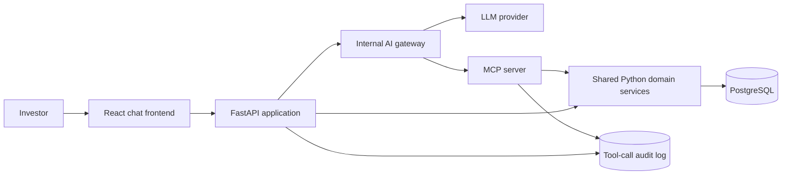

# EquityMetrics MCP

## Purpose

EquityMetrics MCP is a full-stack application for public investors to quickly explore YipitData-style quarterly KPI estimates. It provides the same curated data through a web chat experience for people and an MCP server for AI agents.

The product helps investors discover covered companies and KPIs, compare historical quarterly performance with the latest quarter-to-date (QTD) estimate, and drill into underlying values and dates when needed.

## Product scope

The first release supports:

- Search and discovery of sectors, companies, tickers, and KPIs.
- Historical quarterly KPI estimates aligned to fiscal quarters.
- The latest QTD estimate for a KPI, including its snapshot/as-of date.
- A chat-style interface that answers investor questions by using MCP tools.
- A visible agent activity trace showing tools, arguments, and outcomes.
- Auditable MCP tool-call logs.

Authentication, real-time streaming, vector search, and multi-tenant authorization are deliberately outside the initial scope.

## Architecture



The API and MCP server share the same domain/service layer. This keeps validation, KPI semantics, formatting, and data access consistent across human and agent interfaces.

### AI gateway decision

The application uses an internal `ai_gateway/` module between the FastAPI chat/API layer and the LLM provider. It is not a separately deployed service in the first release:

```text
React chat → FastAPI → internal AI gateway → LLM + MCP tools → KPI services → Postgres
```

The MCP server remains the authoritative data interface. The gateway owns model-facing concerns only:

- Provider and model configuration, with a path to provider portability.
- API-key isolation, tool-calling orchestration, and deterministic mock mode.
- Request IDs, latency, token/cost metrics, error handling, rate limits, retries, timeouts, and response-size limits.
- Prompt and version management.
- Optional redaction or policy checks before external requests.
- A unified tool trace for the frontend and audit logs.

Keeping this boundary as a module avoids early deployment, network, and operational overhead. It can later be deployed independently without a major interface rewrite if scale, provider diversity, or governance requirements justify it.

## Technology stack

| Area | Technology | Rationale |
| --- | --- | --- |
| Frontend | React, TypeScript, Vite | Fast, typed development of a focused chat experience. |
| Application API | Python, FastAPI | Async-ready, well suited for typed data APIs and LLM orchestration. |
| MCP | Python, FastMCP | Straightforward, discoverable tool definitions for AI clients. |
| Persistence | PostgreSQL | Reliable relational storage for structured estimates, filters, and audit records. |
| Data layer | SQLAlchemy and Alembic | Explicit models, migrations, and portable database access. |
| Local runtime | Docker Compose | Repeatable local setup for API, MCP, web app, and Postgres. |
| Tests | Pytest; Vitest/React Testing Library | Strong backend/MCP coverage with practical UI tests. |
| Observability | Structured JSON logs plus Postgres audit records | Troubleshooting, tool-call inspection, and future monitoring integration. |

The LLM provider is accessed through a small adapter. Development and tests can use a deterministic mock mode; a configured provider enables live tool calling without changing the rest of the system.

## Data model and semantics

The supplied CSV is imported through a repeatable seed process. The normalized model includes:

- `sectors`
- `companies` — canonical name and ticker
- `kpi_definitions` — name, display name, units, and description
- `historical_estimates` — company, KPI, fiscal quarter, value, and as-of metadata
- `qtd_estimates` — company, KPI, fiscal quarter, snapshot date, value, and as-of metadata
- `mcp_tool_calls` — tool, sanitized arguments, outcome, error classification, duration, and correlation ID

Indexes focus on ticker/company lookup and `(company, KPI, fiscal period)` retrieval. QTD data is read as the latest available snapshot because the source refreshes no more than daily.

## MCP tools

The MCP server exposes a compact tool surface designed for natural LLM workflows:

1. `search_companies(query, sector?)` — resolve a company, ticker, or sector-filtered search.
2. `list_company_kpis(ticker_or_company)` — discover the KPIs covered for a resolved company.
3. `get_kpi_estimates(ticker, kpi, periods?)` — return historical quarterly values and relevant metadata.
4. `get_qtd_estimate(ticker, kpi)` — return the newest QTD value, fiscal quarter, units, and snapshot date.

Tools use explicit validation and structured, recoverable errors. An unknown ticker returns an `unknown_company` error with close matches when possible; an unrecognized KPI returns `unknown_kpi` with available KPI suggestions for that company. Every invocation is logged with sanitized arguments and its outcome.

## Delivery plan

### Phase 1 — Repository and data contract

1. Inspect the sample CSV and document its source fields and data-quality assumptions.
2. Define canonical identifiers, fiscal-quarter format, units, and historical/QTD distinctions.
3. Create the database schema, migrations, and repeatable seed importer.

### Phase 2 — Shared backend foundation

1. Implement repository and domain-service layers.
2. Add company/KPI search, historical estimate retrieval, and latest-QTD retrieval.
3. Implement validation, match suggestions, consistent errors, and unit-aware response formatting.
4. Add backend tests for normal and invalid inputs.

### Phase 3 — MCP delivery and auditability

1. Implement the FastMCP server over the shared services.
2. Add tool-call audit persistence, structured logging, correlation IDs, and timing.
3. Document MCP client configuration and verify the tools end to end.

### Phase 4 — AI gateway

1. Define the AI gateway interface and deterministic mock implementation.
2. Add the live LLM provider adapter, tool-calling orchestration, and configuration isolation.
3. Implement request tracing, operational limits, retries, timeouts, and prompt versioning.
4. Return a unified tool trace for frontend display and audit records.

### Phase 5 — Investor chat experience

1. Create the React/TypeScript chat interface and suggested investor prompts.
2. Add a FastAPI agent endpoint that invokes the configured LLM through MCP tools.
3. Return the investor-facing answer together with structured tool-call trace data.
4. Build historical-versus-QTD presentation and KPI/company drill-down affordances.

### Phase 6 — Reliability and handoff

1. Add integration tests for database, API, MCP, and agent traces.
2. Add health/readiness endpoints and a Docker Compose developer workflow.
3. Complete setup, data-import, API, MCP-client, and troubleshooting documentation.
4. Record architectural decisions, future improvements, and responsible use of AI tools.

## Engineering principles

### AI and data engineering

- Prefer a small number of composable, highly descriptive tools over a broad API surface.
- Make entity resolution deterministic and errors actionable for the next LLM tool call.
- Return compact, typed, unit-aware results with fiscal and snapshot dates so the model can distinguish history from QTD.
- Log enough context to audit agent behavior without persisting sensitive prompt content unnecessarily.
- Treat the database as the source of truth; the LLM interprets returned data but does not invent it.

### Software engineering

- Keep business logic independent from FastAPI, FastMCP, and the frontend.
- Keep the AI gateway internally isolated so it can be independently deployed only when justified by scale, provider diversity, or governance needs.
- Start with a modular monolith and one Postgres database; introduce queues, services, or caching only when measured needs arise.
- Use migrations, deterministic seed data, API contracts, and tests to make changes safe.
- Design for daily QTD updates using idempotent imports and simple indexed reads.
- Make configuration environment-based and keep secrets out of source control.

## Future improvements

- Authentication, entitlements, and tenant-aware data access.
- KPI synonym management and richer company-name resolution.
- Derived trend calculations, consensus comparison, and charting.
- Saved conversations, watchlists, and scheduled investor briefs.
- More complete telemetry, dashboards, alerting, and retention policies.
- Production deployment, CI/CD, rate limits, caching, and role-based audit access.

## Responsible use of AI tools

AI-assisted development may be used for implementation acceleration, test-case generation, documentation drafting, and code review. Data contracts, architectural decisions, tool behavior, error handling, and generated changes should be reviewed and validated against the supplied dataset and tests. The product exposes the MCP tool trace to help users distinguish source-derived data retrieval from model-generated narrative.

## Repository layout

```text
equity-metrics-mcp/
├── api/                 # FastAPI app and agent orchestration
├── ai_gateway/          # Internal LLM adapter, tool orchestration, and policies
├── mcp_server/          # FastMCP tools and transport entry point
├── core/                # Shared domain models, services, repositories
├── db/                  # SQLAlchemy models, Alembic, seed importer
├── web/                 # React + TypeScript frontend
├── tests/               # Backend, MCP, and integration tests
├── docker-compose.yml
└── README.md
```
